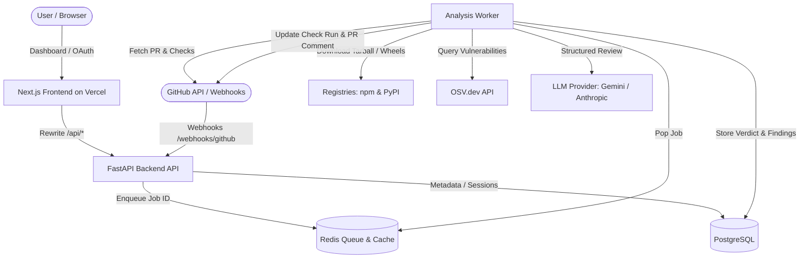

# SupplyShield Architecture

## 1. System Overview

SupplyShield provides automated pre-merge supply chain security analysis for open-source GitHub pull requests and dependency updates. It determines whether inbound code or published package updates introduce malicious behaviors before CVE disclosure.

## 2. Request Flows

### Flow A: Login & Authentication
1. User clicks "Sign in with GitHub" in the browser, hitting `/api/auth/github/login`.
2. Backend generates a random 32-byte cryptographic state, stores it in a short-lived signed HttpOnly cookie, and redirects to GitHub OAuth authorize URL.
3. GitHub redirects back to `/api/auth/github/callback`. Backend verifies state, exchanges code for access token, fetches profile and accessible GitHub App installations.
4. User and installations are upserted. A server-side session token is generated, hashed with SHA-256 for database storage, and returned via `ss_session` cookie (HttpOnly, Secure, SameSite=Lax).
5. The OAuth token is immediately discarded.

### Flow B: GitHub Webhook
1. GitHub delivers `pull_request` event to `/webhooks/github`.
2. API verifies `X-Hub-Signature-256` HMAC-SHA256 signature against raw body; rejects payload > 1 MB.
3. API checks delivery ID against `analyses.delivery_id` unique constraint to deduplicate replay attacks.
4. For `opened`, `synchronize`, or `reopened` actions: upserts repo, creates analysis row with status `queued`, initializes GitHub Check Run to `in_progress`, and enqueues job with analysis ID into Redis queue.

### Flow C: Manual Scan
1. User submits PR URL via dashboard form (`POST /analyses`).
2. API strictly parses URL matching `https://github.com/{owner}/{repo}/pull/{number}`.
3. API verifies caller has access to the repo's GitHub App installation.
4. API creates analysis row, enqueues job, and returns HTTP 202 with analysis ID. Frontend polls until completed.

### Flow D: Analysis Worker Pipeline
1. Check if PR head commit still matches analysis `head_sha`. If superseded, abort scan.
2. Mark status `running`. Fetch PR metadata and changed files using GitHub App installation token.
3. Parse manifests (`package.json`, lockfiles, `requirements.txt`, `pyproject.toml`) to detect dependency version deltas.
4. For each dependency version bump: download published package artifacts from npm or PyPI, safely unpack in isolated sandbox, diff trees, and create package `DiffContext`.
5. Build PR-level `DiffContext` for changed non-dependency repository files.
6. Run static analysis detection rules over all diff contexts.
7. Query OSV.dev for known vulnerabilities.
8. Calculate risk score (0–100), apply caps and security floors.
9. If LLM provider configured, run structured review with prompt injection defenses and secrets redaction. Apply clamped adjustment (-10 to +10).
10. Store verdict, findings, and package snapshots in database.
11. Update GitHub Check Run status (`success`, `neutral`, `failure`) and upsert PR comment with hidden marker `<!-- supplyshield:v1 -->`.
12. Mark analysis status `succeeded`.
